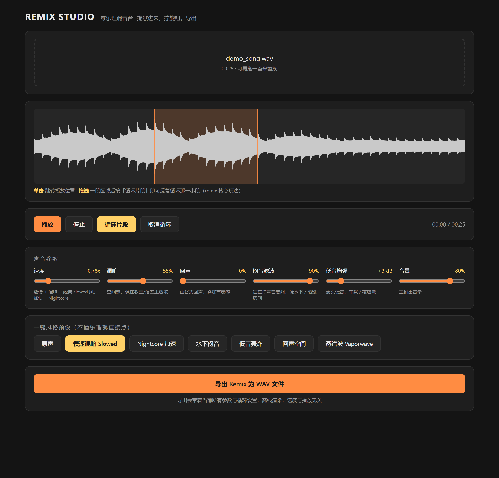

# Remix Studio · 零乐理混音台

不需要乐理知识，拖一首歌进来，拧几个旋钮，就能做出 slowed、Nightcore、水下闷音等风格的 remix。

## 在线使用（点开即用）

**👉 https://kilakiller.github.io/remix-studio/**

无需注册、无需安装，浏览器打开即可使用（推荐 Chrome / Edge）。



## 快速上手

1. **拖入歌曲**：把 mp3 / wav / ogg / m4a 文件拖进页面（或点击选择文件）
2. **点预设**：「慢速混响 Slowed」「Nightcore 加速」「水下闷音」等一键套用
3. **微调旋钮**：速度、混响、回声、闷音滤波、低音增强、音量
4. **循环片段**：在波形上**拖选一小段** → 点「循环片段」，无限循环副歌
5. **导出**：点「导出 Remix 为 WAV 文件」，离线渲染后下载

## 参数说明

| 旋钮 | 原理 | 效果 |
|---|---|---|
| 速度 | 播放速率 0.5–2.0x | 放慢 → slowed 风；加快 → Nightcore（音高随之变化） |
| 混响 | 卷积混响（自生成 2.5s 脉冲响应） | 教堂 / 浴室空间感 |
| 回声 | 0.35s 延迟 + 40% 反馈 | 山谷式回声，叠加节奏感 |
| 闷音滤波 | 低通滤波 200Hz–18kHz 对数扫频 | 往左拧变闷，水下 / 隔壁房间 |
| 低音增强 | lowshelf @200Hz，0–15dB | 车载 / 夜店轰头低音 |
| 音量 | 主输出增益 | 防止削波 |

## 一键预设

| 预设 | 参数取向 |
|---|---|
| 原声 | 全部归零 |
| 慢速混响 Slowed | 0.78x + 55% 混响 + 轻微闷音 |
| Nightcore 加速 | 1.3x + 少量回声 |
| 水下闷音 | 0.92x + 强低通 + 空间混响 |
| 低音轰炸 | +12dB 低音 |
| 回声空间 | 70% 延迟回声 |
| 蒸汽波 Vaporwave | 0.7x + 混响 + 回声 + 闷音 |

## 技术说明

- **纯前端单文件**：整个应用就是一个 `index.html`，无框架、无构建、无外部依赖
- **Web Audio API**：`BiquadFilter`（低通 / lowshelf）、`ConvolverNode`（混响）、`DelayNode` 反馈环（回声）
- **离线渲染导出**：`OfflineAudioContext` 重放完整效果链，自实现 16-bit PCM WAV 编码；循环模式导出 8 遍素材
- **波形可视化**：Canvas 峰值采样绘制，支持单击跳转、拖选循环区

### 本地运行

```bash
# 方式一：直接双击 index.html
# 方式二：起个本地服务
python -m http.server 8000
# 打开 http://localhost:8000
```

### 程序化接口（调试 / 自动化测试用）

```js
await RemixStudio.loadFile(file);   // 加载音频
await RemixStudio.renderMix();      // 离线渲染，返回 WAV Blob
RemixStudio.state();                // 当前状态快照
```

## 已知限制

- 变速会同时变调（`playbackRate` 的特性，也是 slowed / Nightcore 风格的听感来源）；变速不变调需要相位声码器，暂未实现
- 导出为无损 WAV，体积较大；需要 MP3 可自行转换
